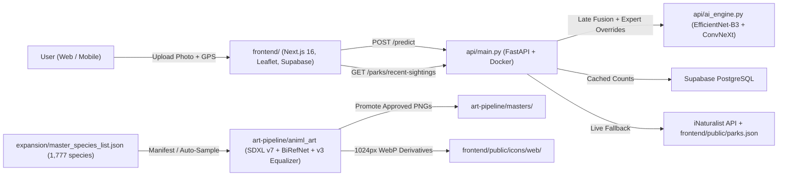

# AnimlVision Architecture

AnimlVision consists of four cleanly separated subsystems inside one monorepo:

## 1. Web Frontend (`frontend/`)
- Next.js 16 App Router application with Tailwind CSS v4 (`@tailwindcss/postcss`), Leaflet species/park mapping, Supabase Auth, and the Anidex encyclopedia.
- Species illustrations are served statically as 1024px WebP assets from `frontend/public/icons/web/`.

## 2. Production Vision API (`api/` + `Dockerfile`)
- `api/main.py` exposes `/predict`, `/species`, `/parks/observations`, `/inat/observations`, `/inat/batch`, and `/parks/recent-sightings`.
- `api/ai_engine.py` runs an ensemble of `WildlifeLateFusion` backbones (`EfficientNet-B3` + `ConvNeXt-Tiny`) combining image features with normalized `[lat, lng, month]` metadata + hierarchical family/class heads and expert disambiguation rules.
- Deployed via `.github/workflows/huggingface.yml` on pushes to `main`. Weights (`oogway_b3_best.pth`, `oogway_convnext_final.pth`) are downloaded at Docker build time from GitHub Releases rather than committed to git.

## 3. Species Expansion Catalog (`expansion/`)
- Defines the 1,777-species North American non-fish tetrapod + iconic elasmobranch target roster (`master_species_list.json`), split into `1,702` direct species IDs and `75` cryptic genus-candidate groups (`MASTER_SPECIES_LIST.md`).

## 4. Automated Art Pipeline v7 (`art-pipeline/`)
- Converts curated reference photos from iNaturalist and Wikimedia Commons into style-locked 1024x1024 cel-shaded wildlife illustrations matching the 45-image `animl_style_v7` LoRA (`art-pipeline/docs/PIPELINE_V7.md`).
- Strictly isolates heavy GPU stages across child processes (`OpenCLIP` -> `Ollama gemma3:27b` -> `Depth-Anything-V2` -> `SDXL + MultiControlNet` -> `BiRefNet + v3 Outline Equalizer`) so a single 16 GB GPU (RTX 5080) completes batches without OOM.
